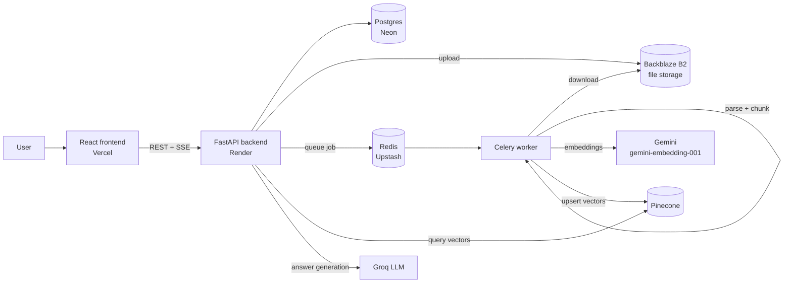

# AI Personal Knowledge Engine

Turn your documents, videos, web pages and workspace tools into one searchable knowledge base, then **chat with it**, **quiz yourself** and **generate study material** — all grounded in your own content.

Upload a PDF, paste a YouTube link, or connect Notion, Slack, Jira or Google Drive. The engine splits everything into chunks, stores their meaning as vectors, and answers your questions using only the most relevant passages, with the sources shown.

**Live app:** https://ai-i-personal-knowledge-engine.vercel.app

---

## Features

- **Chat with your knowledge** – ask questions and get streamed answers (RAG) with the source files listed.
- **Many ways to add content**
  - File upload: PDF, DOCX, TXT
  - YouTube videos (including Shorts)
  - Any public website URL
  - Integrations: **Notion**, **Slack**, **Jira**, **Google Drive**
- **Study tools** – generate **flashcards**, **summaries** and **ELI5** (explain-like-I'm-5) answers from a project's content.
- **Quizzes** – auto-generated multiple-choice quizzes with scoring and attempt history.
- **Projects** – keep topics separate; each project has its own isolated vector namespace and chat history.
- **Teams** – invite people to a project, with owner and member roles.
- **Analytics dashboard** – overview of your activity and quiz performance.
- **Authentication** – email/password and Google sign-in (JWT based).
- **Contact form** – visitors can message you from the landing page.

---

## How it works



**Ingestion:** a file or link is saved, and a background Celery task extracts the text, splits it into 500-character chunks (50 overlap), embeds each chunk with Gemini, and stores the vectors in Pinecone under the project's namespace.

**Answering:** your question is embedded, the closest chunks are retrieved from Pinecone, and they are passed to the LLM as context. The answer streams back to the browser along with the source file names.

**YouTube:** the transcript library is tried first; if YouTube blocks the server's IP, Gemini reads the public video directly and returns its spoken content.

---

## Tech stack

| Layer | Technology |
| --- | --- |
| Frontend | React 19, Vite, React Router, Tailwind CSS 4, Recharts, Framer Motion, GSAP |
| Backend | FastAPI, SQLAlchemy, Alembic, Celery |
| Database | PostgreSQL (Neon) |
| Vector search | Pinecone |
| Embeddings | Google Gemini (`gemini-embedding-001`, 1536 dimensions) |
| LLM | Groq (`openai/gpt-oss-120b`) |
| Queue / broker | Redis (Upstash) |
| File storage | Backblaze B2 (S3-compatible) |
| Email | Resend |
| Auth | JWT, Google OAuth |
| Hosting | Vercel (frontend), Render (backend + worker) |

---

## Project structure

```
.
├── backend/
│   ├── main.py                 # FastAPI app and all API routes
│   ├── requirements.txt
│   ├── alembic/                # database migrations
│   └── app/
│       ├── models.py           # SQLAlchemy models
│       ├── database.py         # DB engine and session
│       ├── auth.py, jwt_handler.py
│       ├── celery_worker.py    # background ingestion task
│       ├── parser.py           # PDF / DOCX / TXT text extraction
│       ├── chunker.py          # text splitting
│       ├── vector_store.py     # Gemini embeddings + Pinecone
│       ├── llm_service.py      # chat, quiz, flashcards, summary, ELI5
│       ├── storage.py          # Backblaze B2 upload/download
│       ├── contact.py          # contact form (Resend)
│       ├── extractors/         # YouTube and website extractors
│       └── integrations/       # Notion, Slack, Jira, Drive
└── frontend/
    └── src/
        ├── pages/              # Dashboard, Analytics, Login, Register
        ├── components/         # Chat, Quiz, Study tools, Sidebar, integrations
        ├── landing/            # public landing site and contact page
        ├── context/            # auth state
        └── api/                # axios client and config
```

---

## Getting started (local development)

### Prerequisites

- Python 3.11+
- Node.js 20+
- Accounts / API keys for: Neon (Postgres), Pinecone, Google AI Studio (Gemini), Groq, Upstash (Redis), Backblaze B2

### 1. Clone

```bash
git clone https://github.com/TusharSamaniya/AiI-Personal-Knowledge-Engine.git
cd AiI-Personal-Knowledge-Engine
```

### 2. Create the Pinecone index

Create an index named **`knowledge-engine`** with **1536 dimensions** and the **cosine** metric. (The dimension must match `EMBED_DIM` in `backend/app/vector_store.py`.)

### 3. Backend

```bash
cd backend
python -m venv .venv
source .venv/bin/activate        # Windows: .venv\Scripts\activate
pip install -r requirements.txt
```

Create `backend/.env` (see [Environment variables](#environment-variables)), then run the database migrations and start the API:

```bash
alembic upgrade head
uvicorn main:app --reload
```

The API runs at http://localhost:8000.

### 4. Celery worker

In a second terminal (same virtual environment, inside `backend/`):

```bash
celery -A app.celery_worker.celery_app worker --pool=solo --loglevel=info
```

Without the worker, uploads and links stay stuck on **Processing**.

### 5. Frontend

```bash
cd frontend
npm install
```

Create `frontend/.env`:

```dotenv
VITE_API_URL=http://localhost:8000
```

```bash
npm run dev
```

The app runs at http://localhost:5173. Set `FRONTEND_URL=http://localhost:5173` and `BACKEND_URL=http://localhost:8000` in `backend/.env` while developing locally.

---

## Environment variables

### Backend (`backend/.env`)

| Variable | Purpose |
| --- | --- |
| `DATABASE_URL` | Postgres connection string (SQLAlchemy format) |
| `SECRET_KEY` | Secret used to sign login (JWT) tokens — use a long random value |
| `SESSION_SECRET` | Secret for the OAuth session middleware |
| `GOOGLE_CLIENT_ID`, `GOOGLE_CLIENT_SECRET` | Google sign-in and Drive |
| `GEMINI_API_KEY` | Embeddings and YouTube video reading |
| `GEMINI_VIDEO_MODEL` | Model used to read YouTube videos (e.g. `gemini-3.8-flash`) |
| `GROQ_API_KEY` | LLM for chat, quizzes and study tools |
| `PINECONE_API_KEY` | Vector database |
| `REDIS_URL` | Celery broker — must be a **read-write** user (`rediss://default:...`) |
| `R2_ACCESS_KEY_ID`, `R2_SECRET_ACCESS_KEY`, `R2_BUCKET_NAME`, `B2_REGION` | Backblaze B2 file storage |
| `FRONTEND_URL`, `BACKEND_URL` | Used for CORS and OAuth redirects |
| `NOTION_CLIENT_ID`, `NOTION_CLIENT_SECRET`, `NOTION_REDIRECT_URI` | Notion integration |
| `SLACK_CLIENT_ID`, `SLACK_CLIENT_SECRET`, `SLACK_REDIRECT_URI` | Slack integration |
| `JIRA_CLIENT_ID`, `JIRA_CLIENT_SECRET`, `JIRA_REDIRECT_URI` | Jira integration |
| `RESEND_API_KEY` | Sends contact-form emails |
| `CONTACT_TO_EMAIL` | Inbox that receives contact-form messages |
| `CONTACT_FROM_EMAIL` | *(optional)* sender address; defaults to Resend's test sender |

### Frontend (`frontend/.env`)

| Variable | Purpose |
| --- | --- |
| `VITE_API_URL` | Base URL of the backend (no trailing slash) |

> **Never commit `.env` files.** They are listed in `.gitignore`. If a key is ever exposed, rotate it immediately.

---

## Deployment

### Frontend — Vercel

1. Import the repository and set the **root directory** to `frontend`.
2. Add `VITE_API_URL` pointing to your backend URL.
3. `vercel.json` already rewrites all routes to `index.html` for client-side routing.

### Backend — Render

1. Create a **Web Service** with root directory `backend`.
2. Build command: `pip install -r requirements.txt`
3. Add all backend environment variables.
4. The ingestion worker must run alongside the API. Two options:
   - **Separate Background Worker** (recommended, paid): start command
     `celery -A app.celery_worker.celery_app worker --loglevel=info`
   - **Single free service:** run both in one start command
     ```
     celery -A app.celery_worker.celery_app worker --pool=solo --loglevel=info & uvicorn main:app --host 0.0.0.0 --port $PORT
     ```
5. Register the OAuth redirect URIs in each provider's console:
   - `https://<your-backend>/auth/google/callback`
   - `https://<your-backend>/integrations/notion/callback`
   - `https://<your-backend>/integrations/slack/callback`
   - `https://<your-backend>/integrations/jira/callback`

> Free Render instances sleep after inactivity, so the first request after a pause can take about 50 seconds.

---

## API overview

Interactive docs are available at `/docs` when the backend is running.

| Area | Endpoints |
| --- | --- |
| Auth | `POST /auth/register`, `POST /auth/login`, `GET /auth/google`, `GET /user/me`, `PUT /user/update` |
| Projects | `POST /projects/create`, `GET /projects/list`, `POST /projects/switch/{id}`, `DELETE /projects/delete/{id}` |
| Teams | `POST /projects/invite`, `GET /projects/members/{id}`, `DELETE /projects/remove-member/...`, `POST /projects/leave/{id}` |
| Content | `POST /upload`, `POST /ingest/url`, `GET /files/list/{project_id}` |
| Chat | `POST /query`, `POST /query/stream`, `GET /chat/history/{project_id}` |
| Study | `POST /quiz/generate`, `POST /quiz/submit`, `GET /quiz/history/{id}`, `POST /study/generate` |
| Integrations | `/integrations/{drive,notion,slack,jira}/{connect,callback,import}`, `GET /integrations/list` |
| Analytics | `GET /analytics/overview` |
| Contact | `POST /contact` |

---

## Known limitations

- **Scanned PDFs** (images without selectable text) are not supported — there is no OCR step.
- **YouTube** videos must be public; private, age-restricted or live videos cannot be read.
- Changing the embedding model requires **re-indexing** existing content, since vectors from different models are not compatible.

---

## Author

Built by **Tushar Samaniya** — [GitHub](https://github.com/TusharSamaniya)